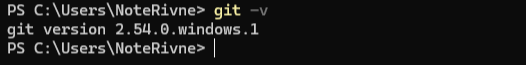
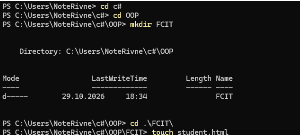
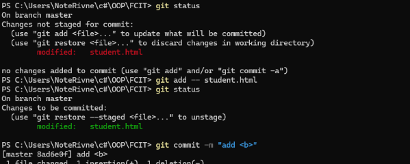
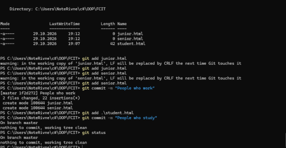
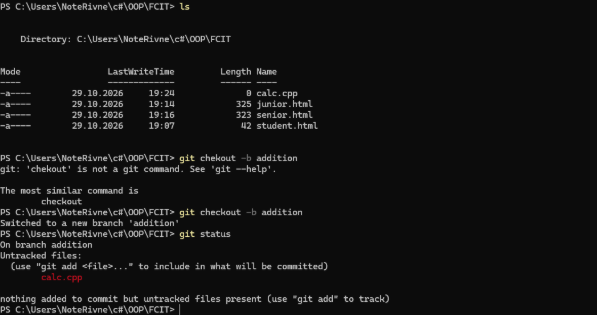
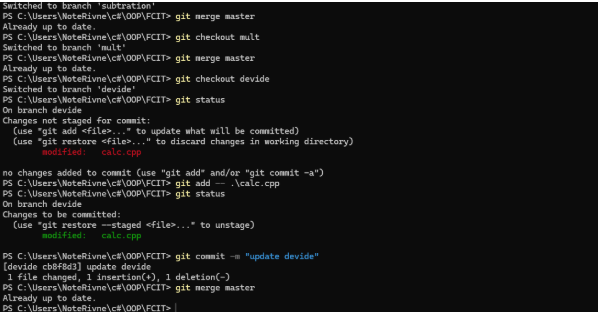

# Лабораторна робота 1: Система контролю версій Git

**Мета роботи:** вивчити основні засоби роботи з репозиторієм Git.

---

## Лабораторне завдання

### 1. Перші кроки у роботі з Git

1. 

2. 

3. 

4–7. 

8, 9. 

10–12. 

---

### 2. Робота з гілками

При роботі над великим проєктом його розбивають на модулі та дають доступ декільком розробникам. Кожен з них робить свою частину, проте їм потрібно буде зібрати ці частини докупи. У такому разі стане у нагоді використання гілок.

1. Спочатку треба створити файл, з якого починатиметься робота. Як приклад пропонуємо створити проєкт «Калькулятор»:

4. 

5. 

6–9. 

---

## Контрольні запитання для самоконтролю

1. **Як створити Git-репозиторій?**  
   Виконати команду `git init` (для нового) або `git clone <url>` (для копіювання існуючого).

2. **Як долучити файл до репозиторія для контролю версій?**  
   Виконати команду `git add <назва_файлу>` (або `git add .` для додавання всіх файлів одразу).

3. **У скількох станах можуть перебувати файли в репозиторії Git?**  
   Існує 4 основні стани: невідстежувані (*untracked*), незмінені (*unmodified*), змінені (*modified*) та проіндексовані (*staged*).

4. **Яка команда використовується для визначення стану файлу в репозиторії?**  
   Команда `git status`.

5. **Для чого використовується файл `.gitignore`?**  
   Використовується, щоб вказати Git, які файли та папки потрібно ігнорувати (наприклад, скомпільований код, тимчасові файли) і не додавати до репозиторію.

6. **Якою командою переглянути непроіндексовані зміни, зроблені після останнього коміту?**  
   Команда `git diff`.

7. **Якою командою виконується фіксація змін?**  
   Команда `git commit -m "повідомлення до коміту"`.

8. **Як видалити файл з Git-репозиторія?**  
   Команда `git rm <назва_файлу>` (видаляє повністю) або `git rm --cached <назва_файлу>` (видаляє з-під контролю Git, але залишає на комп'ютері).

10. **Як переглянути історію комітів?**  
    Команда `git log`.

11. **Як змінити останній коміт?**  
    Команда `git commit --amend` (дозволяє додати забуті файли або змінити повідомлення).

12. **Яка команда створить нову гілку в Git-репозиторії?**  
    Команда `git branch <назва_гілки>` (або `git checkout -b <назва_гілки>`, щоб створити і відразу перейти в неї).

13. **Як об‘єднати гілки А та Б?**  
    Спочатку потрібно перейти в цільову гілку А (`git checkout A`), а потім виконати злиття з гілкою Б командою `git merge B`.

---

## Висновок

Під час виконання практичних завдань та опрацювання контрольних питань було успішно закріплено основи роботи з локальними репозиторіями Git. Засвоєно ключові етапи відстеження файлів (індексація через `add` та фіксація через `commit`), а також навчено керувати станами файлів та ігнорувати непотрібні дані за допомогою `.gitignore`. Практичне знайомство з механізмом гілок (`branch`, `merge`) показало, що Git є критично важливим інструментом для будь-якого розробника, адже він дозволяє безпечно ізолювати експериментальний код, відстежувати повну історію розробки та ефективно об'єднувати різні частини проєкту без ризику втрати даних.
